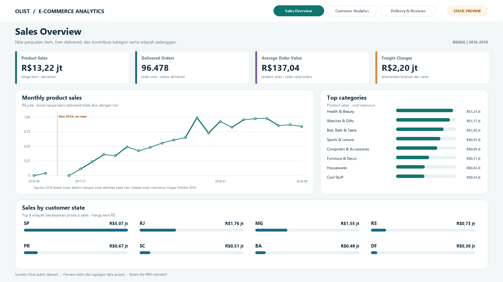
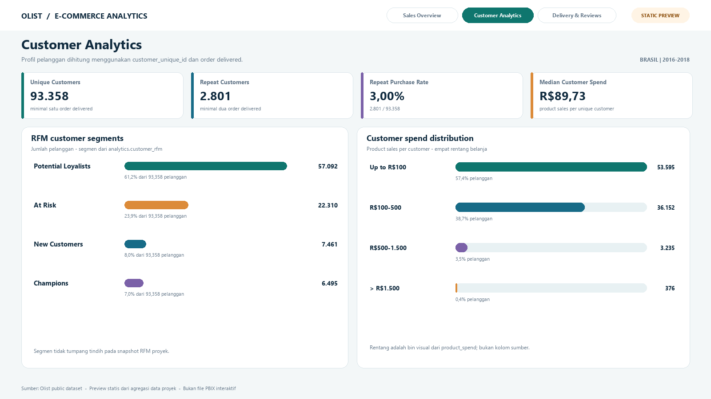
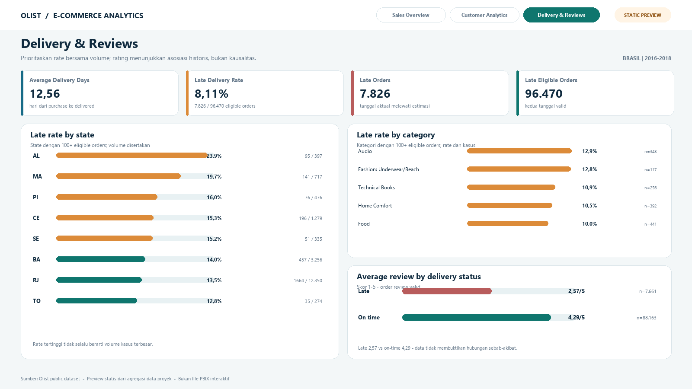

# Dashboard Power BI

Di folder ini ada panduan untuk menyusun laporan Power BI, measure DAX, tema warna, dan preview tiga halaman dashboard.

## Preview halaman

### Ringkasan Penjualan (Sales Overview)

### Analisis Pelanggan (Customer Analytics)

### Pengiriman dan Ulasan (Delivery & Reviews)

## Cara melanjutkan di Power BI

Gambar di atas adalah rancangan statis dari hasil analisis, bukan screenshot atau laporan interaktif. File `ecommerce_dashboard.pbix` belum tersedia.

Untuk membuat laporan, ikuti [panduan koneksi PostgreSQL](../docs/postgresql_powerbi_guide.md) dan [spesifikasi dashboard](PRD_Dashboard_PowerBI.md). Measure di [`powerbi_measures.dax`](powerbi_measures.dax) perlu dibuat satu per satu di Power BI Desktop; tema dapat dimuat dari [`powerbi_theme.json`](powerbi_theme.json). Setelah laporan selesai, simpan sebagai `dashboard/ecommerce_dashboard.pbix` dan letakkan screenshot aktual di `images/`.
